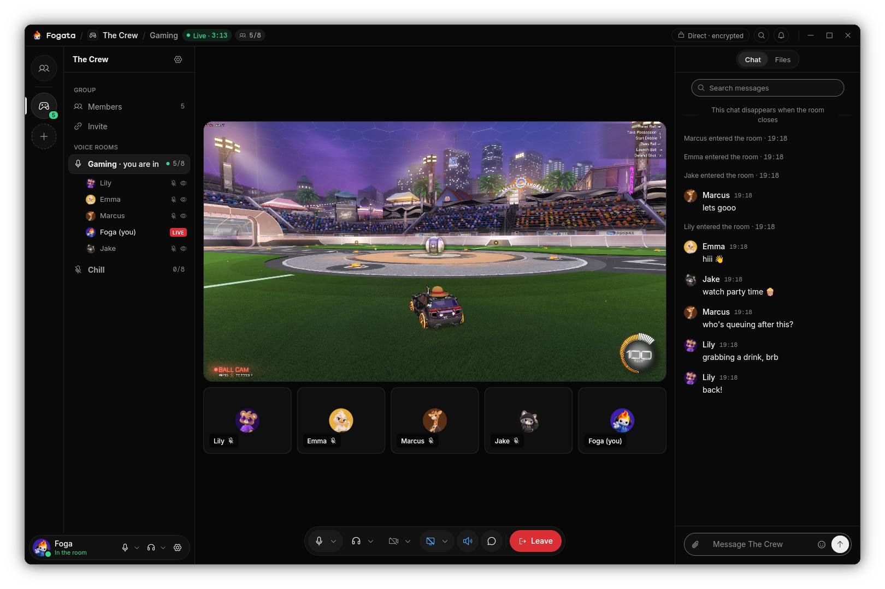

  

  <picture>
    <source media="(prefers-color-scheme: dark)" srcset="docs/images/wordmark-dark.png">
    
  </picture>

  Text, voice and video for small groups of friends, peer to peer. 
  No accounts. No servers. Just your friends.

  
  
  

## Features

<table>
  <tr>
    <th width="33%" align="left"><code>01</code> PEER TO PEER</th>
    <th width="33%" align="left"><code>02</code> VOICE ROOMS</th>
    <th width="33%" align="left"><code>03</code> ENCRYPTED</th>
  </tr>
  <tr>
    <td valign="top">Every device talks straight to the others. No accounts, no Fogata servers, no relays run by anyone else.</td>
    <td valign="top">Groups with voice rooms that light up when someone comes in. Cameras, and screens shared with their sound.</td>
    <td valign="top">Everything a device says is signed by it and encrypted between devices. Direct chats live only on the two devices.</td>
  </tr>
  <tr>
    <th width="33%" align="left"><code>04</code> DIRECT CHATS &amp; CALLS</th>
    <th width="33%" align="left"><code>05</code> FILES</th>
    <th width="33%" align="left"><code>06</code> FITS YOUR DESKTOP</th>
  </tr>
  <tr>
    <td valign="top">Message and call a friend one to one, with pictures, voice messages and messages that disappear on a timer.</td>
    <td valign="top">Share files in a room or a chat, straight from one device to the other, checked on arrival.</td>
    <td valign="top">Linux, macOS and Windows, a tray icon, light and dark looks, and nine languages.</td>
  </tr>
</table>

## Screenshots

  

## How it works

Friends add each other with a one-time link, code or QR code and compare a fingerprint, so each
device knows the other's key. A group is a signed list of its members that every member keeps;
nobody else holds it. Devices find each other through the public IPFS distributed hash table,
used only as a phone book, then connect directly, also through home routers. When two devices
cannot reach each other, another member of the group may carry their traffic, encrypted end to
end.

## Install

Fogata is in pre-release. Builds for Linux (Flatpak), macOS and Windows will be on the Releases
page; until then, build it from source. Nothing is signed with a paid certificate, so your system
asks you to confirm the first start once.

## Privacy

- No account, no sign-in, no phone number or e-mail address.
- No telemetry, analytics or crash reporting. **Settings → Report a problem** writes a report you
  read first and then send yourself, by e-mail or as a file.
- Messages, calls and files go from device to device. Room chats are gone when the last person
  leaves the room; direct chats are kept on the two devices, encrypted on disk.
- What leaves the device besides your friends' and groups' traffic: lookups in the public IPFS
  distributed hash table, which see this device's network addresses, as any peer you connect to
  does.
- Fogata has not yet been reviewed by an outside security auditor. Do not rely on it for anything
  that would put you in danger.

## Translations

The interface is in nine languages: English, Spanish, Brazilian Portuguese, French, German,
Italian, Russian, Japanese and Simplified Chinese. It follows the system language on the first
start and can be changed in Settings.

## Documentation

- [docs/building.md](docs/building.md): building the app and the command-line program, and the
  checks every change passes.
- [docs/cli.md](docs/cli.md): the command-line program.
- [docs/architecture.md](docs/architecture.md): how Fogata works, and its threat model.
- [docs/ci.md](docs/ci.md), [docs/fuzzing.md](docs/fuzzing.md),
  [docs/native-components.md](docs/native-components.md): testing, fuzzing and the native code
  Fogata builds on.
- [docs/translating.md](docs/translating.md): improving a translation.
- [docs/releasing.md](docs/releasing.md), [docs/releasing-beta.md](docs/releasing-beta.md):
  how releases and pre-releases are made and signed.

## License

Copyright © 2026 Holy Panda. Fogata is free software under the
[GNU Affero General Public License, version 3](LICENSE). The licences of the components it
includes are in [THIRD-PARTY-NOTICES](THIRD-PARTY-NOTICES).
